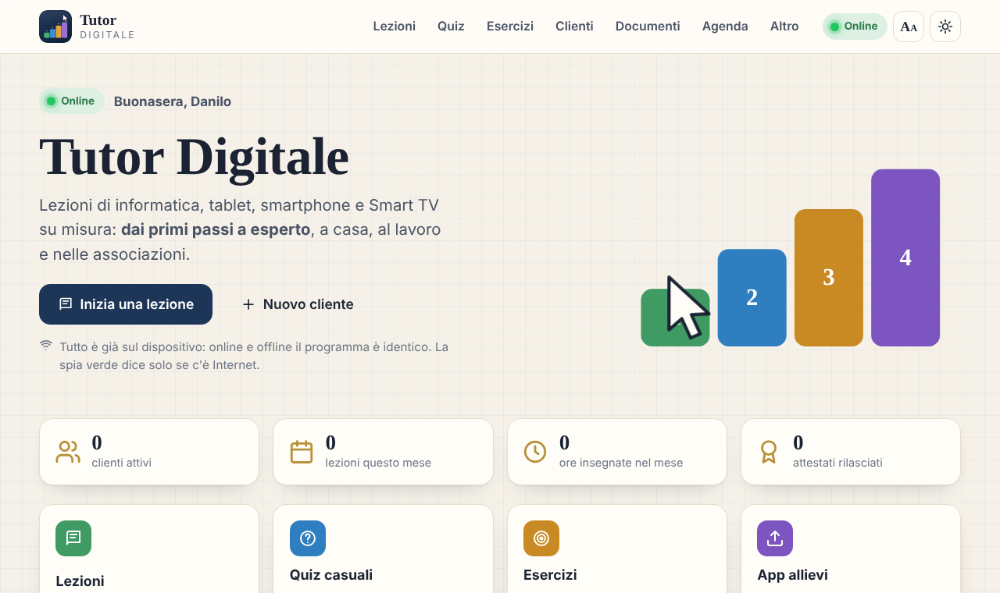

# Tutor Digitale · lezioni di tecnologia su misura

**Lezioni individuali e di gruppo su computer, tablet, smartphone, Smart TV e Internet, dai primi passi a esperto: a casa, al lavoro, nei centri anziani, nelle biblioteche e nelle associazioni.** Quiz che non sono mai uguali, esercizi in tre difficoltà, schede clienti, liberatoria firmabile sullo schermo e attestato finale in PDF. Tutto in italiano, senza account, senza pubblicità, identico online e offline.

**Ideato, scritto e sviluppato da [Danilo D'Auria](https://github.com/danilodauria)** — autore di *Tecnologia Gentile* e di FeniceOS.

[**Apri l'applicazione**](https://danilodauria.github.io/tutor-digitale/) · [Codice su GitHub](https://github.com/danilodauria/tutor-digitale) · [Tutti i progetti](https://danilodauria.github.io/)



---

## Perché esiste

Chi insegna tecnologia a domicilio o nelle associazioni ha bisogno di tre cose insieme: un **programma** ordinato da seguire, **strumenti** per far esercitare e verificare, e **documenti** in regola da far firmare e consegnare. Di solito sono sparsi tra fogli, cartelle e appunti. Tutor Digitale li mette in un unico programma che entra in una borsa: il tablet o il portatile del tutor.

## Che cosa contiene

| Sezione | Contenuto |
|---|---|
| **Lezioni** | 40 lezioni in 4 livelli (Primi passi, Principiante, Intermedio, Esperto) e 5 percorsi (Computer, Tablet, Smartphone, Smart TV, Internet e sicurezza). Ognuna con obiettivi, spiegazione, passi numerati, tre esercizi (facile, medio, esperto), compito a casa, aree DigComp 2.2, lettura ad alta voce e scheda PDF. |
| **Modalità lavagna** | La lezione a tutto schermo, un passo alla volta, con caratteri grandi: per la Smart TV o il proiettore nei gruppi. Frecce della tastiera per avanzare. |
| **Quiz** | Cinque tipi: scelta multipla, vero o falso, completa la frase, metti in ordine, abbina. Domande scelte a caso privilegiando quelle uscite da più tempo; la risposta giusta **cambia posizione** e le risposte **cambiano lettera o numero** (A-B-C, 1-2-3, a-b-c, I-II-III) a ogni partita. Correzione subito o alla fine; risultato salvato nella scheda cliente. |
| **Verifiche su carta** | Ogni verifica stampata ha un codice di versione e domande, ordine e lettere diversi; la chiave di correzione è un PDF separato per il docente. |
| **Esercizi** | 120 esercizi pratici filtrabili per percorso, livello e difficoltà, assegnabili come compito o stampabili. |
| **Palestra** | Mouse (clic, doppio clic, clic destro), trascina e rilascia, tastiera con precisione e velocità, «Truffa o no?» con messaggi veri e falsi, laboratorio password con generatore di frasi-password. |
| **Clienti** | Persone, enti, aziende e gruppi con partecipanti. Scheda con dati, dispositivi e livelli, test d'ingresso, registro delle lezioni con presenze e incassi, percorso svolto, compiti con esito, risultati dei quiz, esportazione CSV. |
| **Liberatoria** | Modulo di iscrizione con informativa privacy (art. 13 GDPR), liberatoria sull'uso dei dispositivi personali e consensi facoltativi. Si firma con il dito o con il mouse, si scarica in PDF, si stampa; c'è anche il **modulo vuoto** da compilare a penna e il **foglio firme** per i gruppi. |
| **Attestato** | Attestato finale A4 orizzontale con intestatario, ore, periodo, livello raggiunto, competenze acquisite, esito delle verifiche, firma del docente e **codice verificabile** (con cifra di controllo) registrato nell'archivio. |
| **Preventivi e ricevute** | Dal listino modificabile, numerati per anno; ricevuta per prestazione occasionale con nota sulla marca da bollo e ritenuta d'acconto facoltativa, oppure riepilogo per chi ha partita IVA. |
| **Agenda e strumenti** | Appuntamenti con esportazione nel calendario (.ics), timer della lezione con promemoria della pausa, kit del tutor, idee per il lavoro e metodo in cinque tempi. |
| **Impostazioni** | Profilo del docente con firma, listino, tema chiaro o scuro, caratteri grandi, copia di sicurezza (esporta e importa). |

## Due app: Tutor e Allievo

| | **Tutor Digitale** (il «server», per il tutor) | **Tutor Digitale · Allievo** (il «client», per il cliente) |
|---|---|---|
| Indirizzo | [danilodauria.github.io/tutor-digitale](https://danilodauria.github.io/tutor-digitale/) | [danilodauria.github.io/tutor-digitale/allievo](https://danilodauria.github.io/tutor-digitale/allievo/) |
| Contiene | tutto: clienti, registro, documenti, attestati, listino, correzione | lezioni, compiti, quiz da consegnare, allenamento, palestra, aiuto a distanza |
| Dati | archivio completo dei clienti | solo il profilo e i compiti di quell'allievo |

Le due app si installano allo stesso modo e funzionano offline, ognuna con il proprio archivio.

### Compiti a distanza con correzione automatica

1. Nella scheda del cliente › **App allievo** il tutor sceglie i compiti e un quiz e crea il **kit**: un link personale (o un file) firmato con un codice segreto di quel cliente. Il quiz viaggia **senza soluzioni**.
2. L'allievo apre il link: l'app si personalizza con il suo nome, i compiti e il quiz. Spunta i compiti fatti, risponde, aggiunge un messaggio o una foto e preme **Invia al tutor**: condivisione (WhatsApp, email…), email, codice da incollare, file o sessione a distanza.
3. Il tutor apre il file in **Scambio con gli allievi**: il programma verifica la firma, **corregge il quiz da solo**, segna i compiti fatti nella scheda e registra il risultato.
4. Il tutor approva o fa rifare i compiti pratici e le foto, aggiunge un commento e **rimanda la correzione**, che l'allievo vede domanda per domanda con le spiegazioni.

A lezione basta un **QR code**: l'allievo inquadra con la fotocamera il kit, la correzione o la sessione di assistenza e l'app si apre già pronta. Le **scadenze** compaiono nella sua home, finiscono nel calendario del telefono con un avviso il giorno prima e, dove il sistema lo permette, arrivano come notifica.

### Assistenza a distanza

Come un TeamViewer semplice e senza installazioni: chi apre la sessione manda un **codice** e detta una **password di 6 cifre** che cambia a ogni sessione e ogni 10 minuti; l'altro rimanda un codice di risposta e i due dispositivi si collegano **direttamente** (WebRTC, cifrato). Si vede lo schermo dell'altro, si scrive in chat, si scambiano file e compiti. Il browser permette di vedere lo schermo ma non di comandare il mouse dell'altro: per il controllo completo si affianca un programma dedicato come RustDesk. Per trovarsi in rete la sessione usa i server pubblici STUN di Google e Cloudflare, che vedono solo gli indirizzi di rete.

## Online e offline

Il programma è una **PWA**: si apre dal browser e si installa come app su Windows, Linux, macOS, Android, iPhone e iPad. Al primo avvio salva sul dispositivo lezioni, quiz, esercizi, modelli e grafiche; da quel momento funziona **identico** anche senza Internet. In alto c'è una spia: **verde** quando c'è connessione, grigia quando non c'è — nient'altro cambia.

PDF, firme, attestati e quiz sono generati sul dispositivo, **senza librerie né servizi esterni**.

## Dati e privacy

Non ci sono server, account o statistiche. I dati dei clienti stanno nel browser del dispositivo del tutor (localStorage). Chi usa il programma per lavoro ne è titolare del trattamento: conviene proteggere il dispositivo con una password ed esportare una copia di sicurezza ogni settimana (*Impostazioni › Esporta backup*).

## Come si prova in locale

```bash
python3 -m http.server 8000      # poi apri http://localhost:8000
node tests/verify.cjs            # verifiche automatiche
```

Le verifiche controllano sintassi, file in cache delle due app, coerenza delle versioni, completezza delle 40 lezioni e della banca delle domande, che in 40 partite consecutive la risposta giusta cambi sempre posizione e stile di numerazione, che il kit non contenga soluzioni, che la correzione automatica sia esatta, che un pacchetto alterato o una password sbagliata vengano rifiutati.

## Licenze

- **Codice** (HTML, CSS, JavaScript, service worker, test): [MIT](LICENSE) © 2026 Danilo D'Auria.
- **Contenuti** (lezioni, domande, esercizi, testi dei documenti, grafiche): [CC BY-NC-SA 4.0](LICENSE-CONTENT.md) — l'uso commerciale da parte di terzi richiede il permesso dell'autore.
- **Nome e logo** «Tutor Digitale»: riservati, vedi [MARCHIO.md](MARCHIO.md).
- I modelli di liberatoria e ricevuta sono una base di lavoro: vanno verificati con un consulente legale, fiscale o privacy prima dell'uso professionale.
- Le aree di competenza fanno riferimento al quadro europeo DigComp 2.2; l'attestato non è un titolo di studio né una certificazione ufficiale.

> «Tutor Digitale — lezioni di tecnologia su misura» di Danilo D'Auria — licenza CC BY-NC-SA 4.0.
